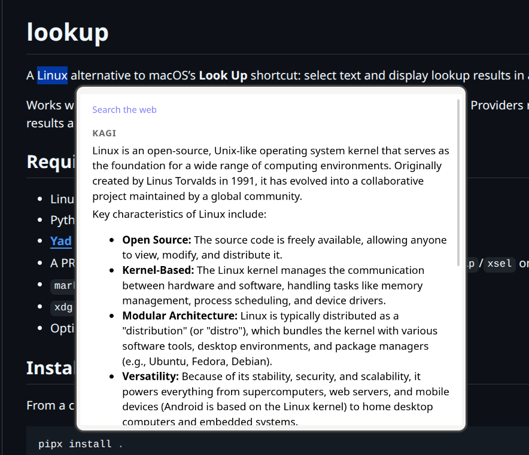

# lookup

A Linux alternative to macOS’s **Look Up** shortcut: select text and display lookup results in a popup.

Works with X11 or Wayland, using a configurable clipboard command and [Yad](https://github.com/v1cont/yad). Providers
run concurrently, with results appearing asynchronously as they arrive.



## Requirements

- Linux desktop running X11 or Wayland.
- Python 3.11 or newer.
- **[Yad](https://github.com/v1cont/yad) with HTML support**; check with `yad --help-html`.
- A PRIMARY-selection reader: `wl-paste` (wl-clipboard) on Wayland, or `xclip`/`xsel` on X11.
- `markdown-it-py` for Markdown formatting.
- `xdg-open` (xdg-utils) to open links in your default browser.
- Optional: `notify-send` for desktop error notifications.

## Install

From a checkout of this repository, install with either:

```sh
pipx install .
# Or:
uv tool install .
```

Python dependencies, including Markdown formatting support, are installed automatically.

### Nix (optional)

```sh
nix run . -- --list-providers
nix build
nix flake check
```

The flake exports `packages.<system>.lookup` and `default`, a default app, and a development shell for x86_64 and
aarch64 Linux. The application includes Markdown support and Yad. Choose a package for the clipboard tools you need:

| Package              | Clipboard tools         | Default selection             |
| -------------------- | ----------------------- | ----------------------------- |
| `lookup` / `default` | `wl-clipboard`, `xclip` | Detect Wayland/X11 at runtime |
| `lookup-wayland`     | `wl-clipboard`          | Wayland                       |
| `lookup-x11`         | `xclip`                 | X11                           |

For example, `nix run .#lookup-wayland` uses the Wayland variant.

In your own flake, add an input pointing to this repository, for example under the name `lookup`. Then in a Home Manager
module with that input in scope:

```nix
home.packages = [ inputs.lookup.packages.${pkgs.stdenv.hostPlatform.system}.lookup-wayland ];
```

Configuration remains an ordinary TOML file. No Home Manager module is required.

## Use

Bind `lookup` to a keyboard or mouse shortcut in your desktop's settings. Then select text in an application and run the
tool, which reads the PRIMARY selection; it does not simulate a copy keystroke.

```sh
lookup --list-providers
lookup --default-config
lookup
lookup --providers dictionary wikipedia
lookup --config /path/to/config.toml
```

## Configure

See the commented [example configuration](examples/config.toml) for all settings and defaults. Copy it to
`$XDG_CONFIG_HOME/lookup/config.toml` (usually `~/.config/lookup/config.toml`), or use `--config PATH`. The file is
optional.

## Providers

The bundled providers are `dictionary` (English Dictionary API), `wikipedia` (English Wikipedia summaries), and `kagi`
(FastGPT). Dictionary and Wikipedia are enabled by default; Kagi's FastGPT API is chargeable and requires an API token.
Use `--providers NAME [NAME ...]` to select providers for one invocation.

### Add a provider

Copy [`_template.py`](src/lookup/providers/_template.py) to `src/lookup/providers/<name>.py`, or use the minimal example
below. The template shows every supported attribute and method override, including optional ones.

**Only three things need editing:**

1. `title`: the label shown in the popup.
2. `url(query)`: the API endpoint. The query is already URL-encoded.
3. `parseResult(data)`: turn decoded JSON into a `Result`, or return `None` for no match.

```python
from ..provider import JSONValue, ProviderBase, Result, jsonObject, jsonString

class Provider(ProviderBase):
    title = "Example"
    method = "GET"  # Or "POST" with a JSON body below.

    @staticmethod
    def url(query: str) -> str:
        return f"https://example.org/search?q={query}"

    @staticmethod
    def body(query: str) -> JSONValue | None:
        return None  # GET requires None; POST requires JSON, e.g. {"query": query}.

    @staticmethod
    def parseResult(data: JSONValue | None) -> Result | None:
        if data is None:
            return None
        return Result(text=jsonString(jsonObject(data).get("answer")))
```

`method` explicitly selects `"GET"` (the default) or `"POST"`. GET requires `body(query)` to return `None`, or you can
omit it. POST requires a JSON body; use `{}` for an empty object.

That's a complete provider: no constructor, factory, or registry edit. The module must export its class as `Provider`;
naming the class `Provider` does that directly. The filename supplies the identifier: `example.py` → `example` →
`[provider.example]`.

Inspect the raw response while writing your parser:

```sh
lookup --test-source example > response.json
```

`--test-source NAME` prints pretty JSON, without invoking the provider's parser or opening a popup. Errors go to stderr
with a nonzero exit status. Providers that treat HTTP 404 as no result print `null`. Once the parser is
ready, use `lookup --providers example` to test the popup.

Only add the following if your API needs them:

| Override        | Purpose                                                                                            | Default          |
| --------------- | -------------------------------------------------------------------------------------------------- | ---------------- |
| `method`        | Explicit HTTP method: `"GET"` or `"POST"`                                                          | `"GET"`          |
| `body(query)`   | Required JSON body for POST; must return `None` for GET                                            | `None`           |
| `defaultConfig` | Declare TOML options and defaults, e.g. `{"timeout": 25, "token-path": "~/.config/example/token"}` | `{"timeout": 8}` |
| `authScheme`    | Authentication scheme when using `token-path`                                                      | `"Bearer"`       |
| `missingOk`     | Treat HTTP 404 as no result                                                                        | `False`          |
| `lowercase`     | Lowercase the query before requesting                                                              | `False`          |

Modules beginning with `_` are excluded from discovery. Only selected providers are imported.

Parsers accept `JSONValue | None` and return `Result | None`. `Result` supports `text`, `title`, `detail`, `links` (a
tuple of `Link`), and `markdown=True`. 

## Development

```sh
python3 -m venv .venv
. .venv/bin/activate
pip install -e .
python -m unittest discover -s tests -v
ruff check src tests
```

Alternatively use `nix develop`. Tests run without live API credentials or a graphical session. Check actual Yad
placement/focus behaviour and clipboard access on your desktop.

MIT licensed; see [LICENSE](LICENSE).
